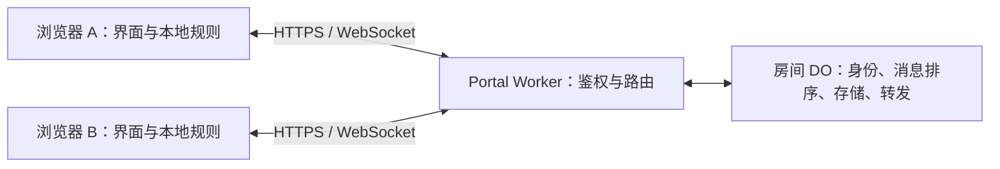

# 将静态游戏接入 Portal 联网：Agent 实施指南

本文面向修改本仓库游戏的 agent。目标是保留现有本地玩法，让两名玩家使用不同浏览器，通过 Portal 登录、邀请、通信和恢复对局。以当前 SDK、Worker 和 Quoridor 实现为依据；修改前仍需阅读对应源码。

部署与管理员操作见 [README.md](README.md)。本文说明游戏如何接入，不要求每个游戏重新实现一套认证或服务端。

## 1. 必须遵守的边界

1. **游戏规则完全在本地执行。** 走子、回合、资源、胜负、悔棋、随机事件及状态恢复由浏览器处理。不要把规则引擎、棋盘判定或游戏专属插件加入 Worker/DO。
2. **服务端只提供通用通信能力。** 它验证身份和房间权限，管理邀请、连接、顺序、去重及有限期消息记录；不理解 `payload` 的游戏含义。
3. **双方诚信并使用相同版本代码。** 即便如此，接收方仍须校验每条消息。收到非法操作时提示本地玩家，不应用该操作，并暂停后续游戏操作；不要求服务器判罚。
4. **页面必须静态。** HTML/CSS/JS 与已有密码学资源由 GitHub Pages 提供。不能为了联网引入运行于 Pages 的 Node/Python 服务、SSR 或数据库。Cloudflare 服务单独部署。
5. **复用 Portal SDK。** 不在游戏中收集 master password，不自行保存管理员会话，不绕过 SDK 拼接长期凭证或 WebSocket 票据。
6. **保留本地模式。** 联网失败不能破坏原本地存档。已有游戏若支持直接打开 `file://`，应保留该模式；联网仍需 HTTPS 或 localhost HTTP。
7. **不要暗中扩展协议能力。** 当前是两个席位、全量日志重放的通信组件，不是通用多人大厅、私密频道或高帧率同步服务。
8. **先检查分支。** 遵守用户和仓库的 AGENTS 指令；分支与任务疑似不一致时暂停修改，不自行新建/切换分支或 worktree 绕过。保留其他工作区改动。



## 2. 开工前的阅读顺序

以下链接均相对于本文，可直接定位实现：

| 文件 | 阅读重点 |
| --- | --- |
| [sdk/client.js](sdk/client.js) | 登录跳转、授权码兑换、创建/加入房间、邀请、凭证恢复 |
| [sdk/transport.js](sdk/transport.js) | 连接事件、全量同步、单条待确认消息、重连与终止 |
| [shared/protocol.js](shared/protocol.js) | 通信版本、编码工具和容量限制 |
| [config.js](config.js) | Worker 地址与游戏 ID/路径注册 |
| [worker/wrangler.jsonc](worker/wrangler.jsonc) | 后端游戏路径白名单、Origin 白名单 |
| [worker/src/registry.js](worker/src/registry.js) | 服务端权限边界；不要只依据按钮判断权限 |
| [worker/src/room.js](worker/src/room.js) | 席位、邀请、日志、去重、过期和关闭行为 |
| [Quoridor 本地消息协议](../game/quoridor/online-protocol.mjs) | 游戏版本、局 ID、局面版本、纯函数重放、双方协商 |
| [Quoridor 界面控制](../game/quoridor/app.js) | 邀请入口、房间生命周期、弹窗、异步响应隔离 |
| [Quoridor HTML](../game/quoridor/index.html)、[CSS](../game/quoridor/style.css)、[布局](../game/quoridor/layout.js) | 游戏内弹窗、右上角 ×、移动端适配 |
| [浏览器联调](tests/browser.mjs)、[服务集成测试](tests/service.test.js)、[密钥权限测试](tests/keys.test.js) | 已经发生过的回归场景和测试环境搭建 |

先查看待改造游戏的规则引擎、UI、存储、随机数和测试。如果它们全部混在一起，先抽出能独立校验操作、确定性重放的规则函数，再接入网络。不要直接复制 Quoridor 的棋盘字段或全部压缩式代码。

## 3. 权限与两类邀请

### 3.1 谁可以做什么

| 身份 | 游戏创建房间 | 加入邀请房间 | Portal 管理 |
| --- | --- | --- | --- |
| 管理员，使用 master password | 完成游戏授权后可以 | 可以 | 可以 |
| 已注册普通游戏密钥 | 完成游戏授权后可以 | 可以 | 不可以 |
| 房间邀请访客 | 不可以 | 仅指定房间 | 不可以 |

管理员和普通密钥持有人从普通游戏入口发起 Portal 登录，最终得到绑定游戏的 `game` 会话。访客通过房间邀请获得绑定房间的 `guest` 会话。

普通密钥登录的中间 `member` 会话仅用于申请游戏授权，不能直接访问管理接口，也不能直接创建房间。游戏只调用 `portal.login()` / `portal.completeLogin()`，无需处理这些中间会话。

**按钮隐藏不是鉴权。** 后端已拒绝 `guest` 创建房间、申请游戏创建授权或调用管理接口。新游戏的 UI 也必须匹配这个边界，不能把邀请访客导向创建房间或管理员登录。

游戏房主身份还绑定游戏客户端公钥。普通密钥的 `keyId` 参与所有权校验；不要修改 SDK 或后端，让不同普通密钥仅凭复用同一浏览器客户端公钥就接管彼此的房间。

### 3.2 不要混淆邀请链接

| 链接 | 入口 | 用途 | 默认期限 |
| --- | --- | --- | --- |
| 房间邀请 | `/game/<id>/#room=...&invite=...` | 认领指定房间的访客席位 | 30 分钟，单次认领 |
| 密钥注册链接 | `/portal/key.html#id=...&secret=...` | 创建可用于今后游戏登录的普通密钥 | 签发后 5 分钟，只登记一个密钥 |

新游戏只需处理第一类。第二类由 Portal 管理后台签发，游戏不能自行生成或模拟。

普通密钥的恢复文件配合个人密钥密码使用；不包含密码或私钥。创建者认证由 Portal 登录页统一处理，游戏不提供自己的“master password 输入框”。

## 4. 注册新游戏

为游戏选择稳定的 `gameId`，例如 `example_game`，并确定唯一返回路径，例如 `/game/example_game/`。

在 [config.js](config.js) 的 `games` 中**保留现有条目并追加**：

```js
// 仅展示新增条目；不要覆盖 apiBase 或其他游戏。
example_game: '/game/example_game/'
```

同步修改 [worker/wrangler.jsonc](worker/wrangler.jsonc) 中 `GAME_PATHS` 的 JSON 字符串，追加相同 ID 和路径。前后端必须一致。

- 注册的是精确路径；`/game/example_game/` 与 `/game/example_game/index.html` 不是同一个授权返回路径。
- 保留当前 `apiBase`、管理员公钥、KDF 配置、DO 绑定和 migration，不为接入游戏重新初始化管理员。
- 默认返回地址无查询参数和 fragment；Portal 用 fragment 携带一次性授权码和 state。
- 同时允许实际页面的 origin。Origin 是协议、主机、端口，不包括 `/portal/` 或游戏路径。
- 修改后端 `GAME_PATHS` 或 `ALLOWED_ORIGINS` 需要重新部署 Worker；只发布静态页面不够。
- 只修改已注册游戏的界面和本地消息处理逻辑时，通常只需更新静态文件。

## 5. 推荐的代码分层

```text
 game/<id>/
   index.html             界面与弹窗
   style.css              原有视觉风格及联网控件
   engine.js              纯本地游戏规则
   online-protocol.mjs    网络事件校验、状态转换、重放
   app.js                 界面、入口路由、联网/本地模式切换
   ...                    现有布局与测试文件
```

小型游戏可以继续在 `app.js` 中管理生命周期；复杂游戏可另建 `network-controller.js`。分层以职责清楚为目标，不为每个游戏复制 Portal 的认证、票据、心跳、重连或密码学代码。

对规则引擎的期望：

- 输入状态和操作，返回新的状态或明确的非法结果。
- 不在校验/重放函数里访问 DOM、localStorage、当前时间或网络。
- 不修改输入状态；失败时保持原局面。
- UI 的合法操作提示与收到网络操作后的验证共用规则逻辑。
- 对随机结果、初始配置、先手和牌堆建立明确的同步方案。

## 6. SDK 实际接口

### 6.1 创建客户端

从游戏目录使用正确的相对路径，或使用站点根路径：

```js
import { createPortal } from '../../portal/sdk/client.js';
const portal = createPortal({ gameId: 'example_game' });
```

若原游戏需要保留 `file://` 本地模式，保持本地规则与 UI 的经典脚本可直接运行，仅在 HTTP(S) 联网路径中动态 `import()` SDK，参考 Quoridor。不要因为将所有脚本改成 ES Module 而破坏原有直接打开 HTML 的玩法。

### 6.2 PortalClient

| 调用 | 返回/行为 | 注意事项 |
| --- | --- | --- |
| `await portal.completeLogin()` | 是否处理了授权码返回 | 处理 `#code=...&state=...`，校验 state，兑换并保存游戏会话 |
| `await portal.login()` | 跳转到 Portal 登录页 | **不会在当前页面继续返回**；发起跳转前保存“创建/恢复房间”的意图 |
| `await portal.credentials()` | 当前创建者游戏凭证 | 无凭证/已过期时抛错；不要将返回的私钥或会话信息展示/记录 |
| `await portal.credentials(roomId)` | 该房间访客凭证，或创建者凭证 | 过期错误的 `status` 为 401；可通过 `scope` 区分访客与创建者 |
| `await portal.createRoom()` | `RoomConnection` | 本身不连接 WebSocket；仅创建者调用 |
| `await portal.join(roomId, invite)` | `RoomConnection` | 兑换邀请并保存访客身份；由明确的“加入”操作触发 |
| `portal.room(roomId)` | `RoomConnection` | 恢复已知房间，不重新消费邀请 |
| `await portal.createInvite(roomId)` | `{ url, expires }` | 仅房主；新邀请使旧邀请失效，席位已占用时失败 |
| `await portal.roomAction(roomId, action)` | 操作响应 | 常用 `info`、`revoke-invite`、`reset-guest`、`close`；服务端验证权限 |

`roomAction(..., 'info')` 可获取房间信息与当前身份的席位。正常游戏通信不必每步调用它。WebSocket 票据由传输组件自行处理，不要手工调用 `ticket` 再拼接 URL。

### 6.3 RoomConnection

| 成员 | 含义 |
| --- | --- |
| `room.id` | 房间 ID |
| `room.seat` | 房主席位 0、访客席位 1；以同步消息确认为准 |
| `room.seq` | 最后收到的服务端日志序号 |
| `room.ready` | 传输层已收到同步消息；不代表游戏校验成功 |
| `room.pending` | 尚未确认的单条发送消息，空时为 `null` |
| `room.stopped` | 自动重连已停止 |
| `room.on(type, callback)` | 注册事件；回调直接收到 detail，返回 room 自身 |
| `await room.connect()` | 发起取票与连接 | 
| `await room.send(payload)` | 发送游戏自定义对象，等待确认 |
| `room.reconnect()` | 主动重新取票并连接，随后收到完整同步 |
| `room.disconnect()` | 停止重连并断开本地连接，取消本地待确认操作；**不删除服务端房间、不释放访客席位** |

**`await room.connect()` 不代表已经连上，更不代表棋盘可以操作。** 等待 `sync` / `status: connected`，并完成本地重放后，再结合 `room.ready`、本地错误状态与游戏规则开放操作。

`room.send()` 的参数只包含游戏 payload，不是完整 WebSocket envelope。不要自己添加 SDK 使用的外层 `type/id/expectedSeq`，也不要直接访问 `room.ws.send()` 来发送正常游戏操作。

SDK 没有 `room.on('state')`、`sendAction()`、私信、服务器游戏快照或服务器胜负判定等接口。`room.on()` 也不返回取消监听函数；切换房间时断开旧对象并在回调中校验房间身份。

### 6.4 事件契约

| 事件 | detail | 游戏应做的事 |
| --- | --- | --- |
| `sync` | `{ type, events, seq, seat, gameId }` | 校验游戏 ID，完整重放到候选状态，成功后替换模型；不要弹出所有历史事件通知 |
| `event` | `{ seq, id, seat, payload }` | 校验并应用一条新游戏事件；发送方也会收到自己的事件 |
| `presence` | `{ type, joined, online }` | 更新席位与在线状态；`online` 为席位数组 |
| `pending` | `true` / `false` | 禁用/恢复发送控件；清空 pending 不代表对方认可操作合法 |
| `status` | `connecting` / `connected` / `disconnected` / `closed` | 更新连接状态并处理恢复或终止 |
| `error` | `Error`，可能带 `status`、`code`、`scope` | 保留错误上下文；区分业务失败、断线、过期、撤销及关闭 |

`joined` 表示访客席位已认领，不表示对方此刻在线。对于任一玩家，对方在线可用 `online.includes(1 - room.seat)` 判断。

`ack` 由 SDK 内部消费，不会作为普通 `room.on('ack')` 事件公开。`closed` 消息也会被转换成 error/status，不要只监听原始 `closed`。

## 7. 三条入口流程

### 7.1 普通入口：创建房间

1. 普通打开游戏时仍可直接玩本地模式。
2. 点击“联网 → 创建房间”后，调用 `portal.credentials()`。
3. 如果需要登录，先保存该游戏独立的创建意图，再调用 `portal.login()`。
4. 返回游戏后调用 `portal.completeLogin()`。成功才继续先前的创建意图，消费后清除标记，避免刷新再建一间。
5. `await portal.createRoom()` 得到房间对象，绑定事件，然后连接。
6. 收到空日志且当前席位是 0 时，由房主发送一次初始化事件。
7. 房主在菜单中生成并复制邀请，等待访客加入。

不要把 `credentials()` 的任意异常都当成未登录，例如配置错误、存储不可用应展示实际原因。也不要让邀请访客的 401 自动触发房主登录。

### 7.2 邀请入口：只能加入

页面最早阶段即解析 `location.hash`，在异步加载 SDK 前确定邀请模式。默认隐藏创建控件，避免加载期间闪现可点击的“创建房间”。

1. 读取 `room` 和 `invite` 后，使用 `globalThis.history.replaceState()` 清理地址栏。
2. 必要时将尚未兑换的邀请放入该游戏专属 sessionStorage；兑换成功、放弃或确定失效后清理。
3. 邀请模式只显示“加入邀请对局”，不显示创建房间、普通房主登录或与该邀请无关的恢复入口。
4. 点击加入后调用 `portal.join(roomId, invite)`，再绑定事件、连接。
5. 已认领的访客通过保存的身份重连，不能继续用旧邀请反复加入。
6. 链接过期、已被其他人使用或已撤销时，提示具体原因。不要把加入失败转成创建房间。

即使当前浏览器保存过创建者会话，从邀请入口进入也不能显示创建按钮。该 UI 规则不等于撤销已有凭证；服务端仍独立按会话权限检查。

还必须监听 `hashchange`：同一页面再次打开新邀请时，浏览器可能只变更 fragment，并不重载脚本。当前连接的是另一房间时，用自定义弹窗确认后再切换；已经在同一房间时，不要再次消费链接。

### 7.3 恢复已有房间

保存房间 ID 与入口状态，使用 `portal.room(roomId)` 建立新连接；不要把邀请密钥当作持久重连凭证。

建议区分：

- **活动房间**：刷新后尝试恢复。
- **主动离开的最近房间**：只提供“恢复房间”，不要刷新就自动把用户拉回。
- **已关闭/过期/撤销的房间**：删除恢复入口。

普通密钥在另一个浏览器恢复成功，不意味着新浏览器拥有旧的游戏客户端席位。不要通过客户端复制 `seat` 来“恢复”别的设备的身份。

## 8. 本地游戏协议设计

### 8.1 区分三种版本

| 字段 | 负责什么 |
| --- | --- |
| 游戏 `version` | 消息格式与规则语义兼容性，例如 `example-net-v1` |
| `roundId` | 同一房间内的某一局，重开时更换 |
| `revision` / payload 中的 `base` | 当前局面版本；用于拒绝旧局面上的操作 |

服务端另有 `seq`，是**整个房间**的日志顺序。协商、认输和新局等消息也占 seq，它不等于游戏手数。重开棋局不清零 `room.seq`，也不会删除旧局日志。

Quoridor 的 `base` 对应局面 revision，协商提案/拒绝不一定增加它；如果新游戏选择其他定义，需要明确并全程保持一致，不能混用 `seq` 与 revision。

### 8.2 建议的消息类型

```js
// 以下是游戏自定义 payload 示例，不是 Portal 内置规则。
{
  version: 'example-net-v1',
  kind: 'init',
  roundId: '随机且唯一的局ID',
  turn: 0,
  settings: { /* 双方确认的本局设置 */ },
  seed: '同步随机过程所需的种子'
}
```

```js
{
  version: 'example-net-v1',
  kind: 'action',
  roundId: '当前局ID',
  base: 12,
  action: { type: 'move', from: 3, to: 4 }
}
```

这些字段由游戏定义；根据实际玩法裁剪。不要照搬不相关的棋盘尺寸、资源或动作。

建议将同意悔棋/重开设计为 `propose` 与 `respond` 两类消息，并包含提案 ID。提案应绑定局 ID 和局面版本，只允许对方回复。收到拒绝时清除提案并保持棋盘；同意时双方执行相同转换。关闭弹窗只表示暂时不处理，不等于同意或拒绝。

### 8.3 初始化与随机性

- 当前房主席位为 0，不一定代表先手；角色/先手属于游戏初始化数据。
- 仅房主在空日志上发送初始化，且要检查没有未确认消息。两个浏览器不能各自初始化。
- 房主生成随机先手、种子或初始结果，通过初始化事件发送；双方应用收到的同一事件。
- 同步随机种子时，双方必须使用同一确定性 PRNG 和相同消费顺序。
- 重放期间不能调用 `Math.random()`、读取当前时间或依赖本地语言/时区重新决定游戏状态。
- 使用时间限制的游戏必须另行定义双方认可的时间语义；Portal 当前没有游戏计时裁判。

### 8.4 状态提交原则

发送前可本地试算并展示预览，但正式棋盘以收到的有序事件为提交依据：

```text
用户输入
→ 本地检查能否发送（身份、连接、轮次、pending、当前提案）
→ 使用规则函数预检查
→ room.send(payload)
→ 服务端持久化并广播
→ 双方本地校验同一 event
→ 更新模型和渲染
```

不能先在发送函数中正式走一步，又在收到自己的广播时走第二步。`await room.send()` 成功只表示传输确认，不表示服务器检查了规则，也不证明另一端接受了这条游戏操作。

推荐操作许可至少包含：已连接、初始化完成、没有本地校验错误、没有待确认消息、席位正确、符合游戏回合规则、没有阻塞性的协商。是否允许对方离线时完成自己的一手，由游戏明确决定；离线客户端自身不能继续本地落子后擅自覆盖服务端日志。

### 8.5 纯函数校验与重放

参考 Quoridor 的接口形状，为自己的游戏实现：

```js
// 这是游戏需要编写的适配层，不是 SDK 提供的函数。
export function applyEvent(engine, model, event) {
  // 验证 version、可信的 event.seat、roundId、base、字段类型和规则。
  // 成功返回新模型，失败抛出明确错误；不要修改 model 或发送网络消息。
}

export function replay(engine, events) {
  // 从未初始化状态开始，验证连续 seq，逐个调用 applyEvent。
  // 返回完整候选模型；失败时由控制器保留最后可信局面并提示。
}
```

`event.seat` 由服务端绑定的连接身份提供，是动作发送者来源。不要信任 payload 自报的 `player` / `seat`，也不要依据用户名推断权限。

收到非法事件时：保留当前可信模型、禁用后续动作、显示来自哪一方的哪条消息及失败原因。不能静默跳过非法事件后继续使用后面的日志。

全量重放应先构造候选模型，全部成功后一次替换当前模型。不要在重放过程中触发提示音、弹出历史悔棋请求结果、发送消息或重复写本地存档。仍待处理的提案需要重新展示。

## 9. 连接控制器与异步安全

绑定事件必须发生在 `connect()` 之前。以下展示事件接线方式，其中 `rules`、`applyEvent`、`replay`、渲染和提示函数均由游戏提供，不是 Portal API：

```js
// 控制器示意；入口、初始化、弹窗和结束清理还需按本文实现。
let currentRoom = null;
let model = null;
let paused = false;

async function attach(room) {
  currentRoom?.disconnect();
  currentRoom = room;
  model = null;
  paused = false;

  room.on('sync', data => {
    if (currentRoom !== room) return;
    try {
      if (data.gameId !== GAME_ID) throw new Error('房间与游戏不匹配');
      const next = replay(rules, data.events);
      model = next;
      paused = false;
      render();
      // 空日志由席位 0 发送 init，且必须检查 room.pending。
    } catch (error) {
      paused = true;
      showLocalValidationError(error);
    }
  });

  room.on('event', event => {
    if (currentRoom !== room || paused) return;
    try {
      model = applyEvent(rules, model, event);
      render();
      // 仅对本次实时事件显示协商结果等通知。
    } catch (error) {
      paused = true;
      showLocalValidationError(error);
    }
  });

  // 还必须接入 presence、pending、status、error，见第 6 节。
  await room.connect(); // 此处返回时不能直接启用棋盘。
}
```

必须覆盖以下竞态：

- **旧房间回调**：回调先检查捕获的 room 是否仍是当前房间；换房后旧事件不能覆盖新模型。
- **迟到的 HTTP 响应**：生成邀请前捕获 room，响应后再次检查当前房间、连接状态和席位是否已认领。旧响应不能把链接写回已关闭的房间。
- **迟到的加入响应**：捕获当前邀请对象，若用户已切换到其他邀请，不再连接旧返回结果。
- **重复点击**：使用真实 busy 状态禁用按钮，不能被一次普通 render 重新启用。
- **等待中的确认框**：确认回调重新检查捕获的房间、局 ID、模型/提案是否仍有效；不要对已变更的局面执行旧确认。
- **瞬时断线**：SDK 自动重连。不要另外创建第二套重连定时器，也不要手动复制 outbox。
- **旧全局变量**：经典脚本中的 `history` 等全局绑定可能影响其他模块；访问浏览器历史请使用 `globalThis.history` / `window.history`，不要依赖裸名称。

SDK 会处理消息序号、同一 ID 的重复发送、一个 pending 消息、持久化 outbox、连接 generation 和重连退避。游戏负责局面语义，不能收到版本冲突后随意改写旧动作的 `base` 再提交。

## 10. 生命周期：必须分别处理

| 场景 | 对局/连接行为 | UI 和存储行为 |
| --- | --- | --- |
| 临时网络断开 | 保留模型，SDK 自动重连 | 禁用发送，显示重连中；不删除活动房间 ID |
| 对方离线 | 保留房间和席位 | 从在线变离线时提示，不能把离线等同于释放席位 |
| 主动离开 | 调用 `disconnect()`，服务端房间仍在 | 恢复本地模式；活动 ID 转为“最近房间”，允许明确恢复 |
| 刷新 | 通过保存身份连接原房间并全量重放 | 不重新认领邀请，不再生成初始局面 |
| 同席位其他标签页接管 | 旧连接停止，不争抢重连 | 提示已在其他标签页打开；不能无限自动接管回来 |
| 会话过期 | 停止发送；房主可重新授权 | 提供符合身份的恢复操作，不能让访客跳转管理员登录 |
| 访客席位撤销 | 旧访客断开；房间日志保留 | 访客清理旧状态；房主清空链接，允许重新邀请 |
| 房间关闭/过期 | 房间日志、成员和邀请失效 | 删除恢复 ID、旧链接、提案和等待状态；普通创建者可直接新建房间 |
| 普通密钥撤销 | 会话失效，其创建的房间被关闭 | 处理正常的关闭/鉴权失败，不绕过服务端恢复权限 |
| 新一局 | 同一房间追加事件 | 更换 roundId；保留通信 seq 与整份历史日志 |

终止错误可包含以下 WebSocket code：

| code | 含义 |
| --- | --- |
| 4001 | 会话过期或退出登录 |
| 4002 | 同席位被其他连接接管 |
| 4003 | 访客席位撤销 |
| 4004 | 房间关闭或过期 |

SDK 的 `status: closed` 不一定表示服务端房间已被删除；结合之前的 error/code 决定是保留重新授权入口还是彻底清理。不要把 HTTP 409 一律理解为房间关闭，它还可能是版本冲突、席位或记录上限问题。

### 10.1 关闭后必须清理的内容

将这一过程集中成一个控制器函数，而不是散落在按钮和 WebSocket 回调里：

- 停止旧连接、重连和对方离线提示定时器。
- 让旧回调、旧 HTTP 响应、旧确认框失效。
- 清空邀请 URL、过期时间和复制按钮状态。
- 清空当前游戏提案、错误、在线标记和联网模型引用。
- 删除已失效活动/最近房间 ID、未兑换邀请；由 SDK 结束 outbox 等待。
- 关闭或取消旧弹窗，防止新房间里弹出旧请求。
- 恢复进入联网前的本地状态和存档逻辑。
- 根据入口权限恢复菜单；普通入口可新建，邀请模式不能因此自动显示创建房间。

关闭旧房间后新建房间、再次生成邀请，必须在**不刷新页面**的情况下可用。不能把 `location.reload()` 当作唯一的状态清理方式。

### 10.2 邀请 UI 的生命周期

- 只向房主展示邀请操作。
- 生成中防止重复点击；重新生成前清除旧显示，避免误复制已经被替换的链接。
- 成功后保存 URL 与服务端返回的 `expires`，在过期时清空显示。
- 邀请被认领、撤销、席位重置、断开进入不可用状态或房间结束后，不能继续展示旧链接为可用状态。
- 席位已经占用时，说明“邀请其他人前请先重置访客席位”。不要只留下一个不明原因的禁用按钮。
- 重置访客保留棋局，意味着新访客接续同一席位，不等于新开一局。

## 11. 界面规范与参考

### 11.1 布局原则

遵守本仓库的 UI 要求：以核心功能为中心，不虚构 Logo、产品名、口号、营销文案；不添加装饰性 Hero、欢迎区、页脚或不需要的顶部/侧边导航。

保留游戏现有配色、棋盘和主操作布局。通常只需在原操作区加入“联网”按钮、一行有意义的状态和必要的协商入口。

参考结构：

```text
[原游戏棋盘 / 玩家状态]
[回合与操作提示]
[游戏动作] [悔棋] [新一局] [规则] [联网]
你是玩家一 · 已连接 / 等待对手 / 正在重连
[查看协商请求]  ← 仅存在待处理提案时显示
```

联网菜单建议：

| 状态 | 应展示 | 不应展示 |
| --- | --- | --- |
| 普通入口、未连接 | 创建房间；存在最近房间时显示恢复 | 空白邀请输入框、不可用的房主操作 |
| 邀请待认领 | 加入邀请对局、有效的提示、右上角 × | 创建房间、管理员登录、无关房间恢复 |
| 已连接房主、无访客 | 生成邀请；生成后显示链接与复制 | 过期链接、伪造的已连接状态 |
| 已连接房主、有访客 | 同步、重置访客、关闭房间、离开及游戏操作 | 可继续使用的旧邀请 |
| 已连接访客 | 同步、离开及游戏允许的操作 | 链接框、复制链接、生成邀请、房主登录、关闭整个房间 |

空白或失效链接不要以可复制状态展示。用户不需要看到 session ID、私钥、票据、原始 JSON 或服务端实现细节。

### 11.2 所有游戏确认/通知使用自己的弹窗

使用游戏样式的 `<dialog>` 或等价的可访问组件，不使用 `window.alert()`、`confirm()`、`prompt()`。

至少覆盖：

- 收到悔棋/重开请求：明确说明影响，提供同意、拒绝。
- 发起协商：提示等待对方，可关闭弹窗，保留“查看协商请求”入口。
- 请求被同意/拒绝：给发起者明确结果；局面转换后双方获得必要提示。
- 对方离开或断线：说明棋局保留；对方回来后提示恢复。
- 认输、关闭房间、重置席位、主动离开：操作前确认。
- 房间结束、身份撤销、非法操作：说明原因与下一步。

示意 HTML（事件绑定和状态校验由游戏实现）：

```html
<dialog id="requestDialog"
        aria-labelledby="requestTitle"
        aria-describedby="requestText">
  <button class="dialog-close" aria-label="暂时关闭请求">×</button>
  <h2 id="requestTitle">对方请求悔棋</h2>
  <p id="requestText">是否同意撤回上一手，恢复此前的局面？</p>
  <div class="actions">
    <button id="rejectRequest">拒绝</button>
    <button id="acceptRequest">同意</button>
  </div>
</dialog>
```

具体要求：

- 关闭按钮放右上角，显示 ×；移除底部无必要的“返回棋盘”按钮。
- × 和 Escape 只关闭提示，确认框视为取消；不能暗中同意、拒绝提案或退出房间。
- 关闭待处理请求后仍能重新打开；协商结束/房间关闭后清除旧请求。
- 防止多个弹窗相互遮挡；通知排队、按事件 ID 去重，过时的确认自动失效。
- 收到完整历史同步时不重播所有旧通知。
- 对方初次未加入不应弹“对方离开”；由在线变离线再提示，可参考 Quoridor 的约 1.5 秒缓冲，避免正常刷新闪断产生连续弹窗。
- 不声称知道对方是主动退出还是网络中断；当前 presence 无法区分两者。
- 文案使用 `textContent`，不把昵称、别名或错误字符串直接插入 `innerHTML`。
- 支持键盘焦点、可访问名称、窄屏和横屏，弹窗不得遮住自己的关键按钮或产生横向溢出。

现有可复用实现位于 Quoridor 的 `openDialog`、`gameDialog`、`refreshDialogs`、`clearDialogs` 和 `renderNetwork`。它们属于游戏代码，不是 Portal SDK 的公共 UI API；按需要抽取，不能直接假设新游戏全局已有这些函数。

## 12. 能力限制与不适用情况

当前代码中的限制如下，未来以源码常量为准：

| 项目 | 当前行为 |
| --- | --- |
| 人数 | 两个席位：0 和 1 |
| payload | JSON 对象，不能是顶层数组；最多 4 KiB |
| 房间日志 | 最多 2048 条事件或 512 KiB，以先到者为准 |
| 发送频率 | 每个连接每 10 秒最多 30 条业务消息 |
| SDK 待确认发送 | 同时一条 |
| 房间过期 | 最后业务活动后 24 小时；心跳不续期 |
| 重连恢复 | 完整有序日志，没有服务器游戏快照或日志压缩 API |
| 访客邀请重试 | 同一密钥首次认领后两分钟内可幂等重试；长期恢复使用保存的身份 |

不要每帧发送位置、鼠标或动画状态；动画和预览留在本地，发送必要的离散游戏动作。满日志时提示创建新房间，不能把服务器返回的 409 当成无限重试指令。

**所有游戏 payload 都会给双方，并进入共同日志。** 当前没有按玩家过滤的消息、隐藏手牌通道或端到端加密。诚信玩家可以遵守只看自己 UI 的约定，但这不构成保密保证。隐藏信息玩法如需真正防止另一端读取数据，应先说明需求并设计通用扩展，不能把完整牌堆/随机种子广播给双方后声称实现了保密。

需要多人、旁观者、实时物理、高频动作、严格棋钟或私密信息时，先评估通信层扩展及验证范围，不要在单个游戏中暗中绕过现有限制。

## 13. 本地联调与部署

从仓库根目录启动静态服务，例如：

```sh
python3 -m http.server 8004 --bind 127.0.0.1
```

访问 `http://localhost:8004/game/<id>/` 或 `http://127.0.0.1:8004/game/<id>/`。所用 origin 必须在线上 Worker 的 `ALLOWED_ORIGINS` 中；两个主机名是不同 origin。

连接已部署 Worker 时保留 [config.js](config.js) 的 HTTPS 服务地址。本地页面访问线上 Worker 会使用线上真实房间；自动化测试应使用本地 Miniflare 和独立浏览器上下文，参考现有测试，不直接修改生产配置。

常用命令：

```sh
cd portal
npm ci
npm test
npm run test:browser
npm run check:deploy
```

`test:browser` 当前主要覆盖 Quoridor 和 Portal，不会自动覆盖新游戏。必须为新增游戏补充实际双浏览器用例及其规则测试。默认使用系统 Chrome；可通过 `CHROME_PATH` 指定浏览器。临时配置应由测试服务器注入，不提交临时密码、私钥或 `.dev.vars`。

若本环境访问外网需要 HTTP 代理，可给联网命令设置：

```sh
HTTPS_PROXY=http://127.0.0.1:4345 HTTP_PROXY=http://127.0.0.1:4345 npm run deploy
```

该地址是当前开发环境提供的代理，不要写进静态前端或 SDK。正式部署仍按用户授权执行。

CORS 排错时区分 Worker 自己返回的 `403 {"error":"不允许的来源"}`、网络超时和 Cloudflare 错误页。对正确白名单的修改必须在当前运行版本生效；后续 Wrangler 部署还可能覆盖控制台变量。不要用 `mode: 'no-cors'`、放宽成任意来源或关闭浏览器安全机制来绕过问题。

## 14. 必测验收清单

按功能选择有意义的规则/集成/浏览器测试；以下是联网改造的基本验收，不以“两个页面看起来一样”代替验证。

### 入口和权限

- [ ] 普通入口保留本地游戏；创建房间经过 Portal 登录，返回后只创建一次。
- [ ] 管理员与普通密钥均能通过授权创建房间。
- [ ] 未加入的邀请访客只有加入入口；加载阶段也不闪现创建按钮。
- [ ] 已加入访客没有链接框、复制按钮、房主登录或关闭整个房间的控件。
- [ ] 使用 guest 凭证直接调用创建/授权/管理接口仍被服务端拒绝。
- [ ] 同页面打开另一邀请，能触发加入逻辑；有活动房间时先确认切换。
- [ ] 过期、撤销、已占用邀请不会创建房间，也不会暴露创建入口。

### 游戏一致性

- [ ] 只有一个初始化事件，双方获得同一先手、设置、随机过程和初始状态。
- [ ] 正常操作、特殊规则、胜负都在双方得到相同结果。
- [ ] 自己的广播不会重复应用，重复发送不会重复走子。
- [ ] 非当前回合、非法字段、旧局 ID、旧版本和非法行动均由接收方本地拒绝。
- [ ] 失败时保留可信局面并弹窗，不继续应用后续不可信日志。
- [ ] 纯重放不产生网络发送、历史弹窗或随机漂移。

### 协商与界面

- [ ] 悔棋与重开必须由双方协商；同意、拒绝和结果正确提示。
- [ ] × / Escape 不触发破坏性操作，待处理提案还能重新打开。
- [ ] 移动端、横屏、键盘操作可用，弹窗按钮可见。
- [ ] 游戏不触发浏览器原生 alert/confirm/prompt。
- [ ] 邀请被使用、重置或过期后不再展示为可复制的旧链接。

### 房间生命周期与竞态

- [ ] 双方刷新、临时断线和重连能恢复模型与席位。
- [ ] 主动离开后可明确恢复；刷新不会擅自把主动离开的人拉回。
- [ ] 对方离线/重连提示不在首次等待时误报、不因重复 presence 连续弹出。
- [ ] 新标签页接管后旧连接不反复重连争抢。
- [ ] 关闭房间后无需刷新即可新建并生成新邀请。
- [ ] 重置访客后旧身份失效，新访客能接续席位。
- [ ] 旧房间的迟到消息、HTTP 成功或失败响应不能清理/覆盖新房间。
- [ ] 未确认操作在终止连接后结束等待，不让按钮永久处于 busy。
- [ ] 原本地存档未被联网状态覆盖；退出联网恢复本地模式。
- [ ] 已满日志、会话过期、密钥撤销和服务不可用有明确可恢复的反馈。

## 15. Agent 交付要求

完成后说明：新增了哪些联网行为、游戏协议和版本、修改了哪些注册配置、测试了哪些具体场景、哪些能力仍不支持，以及是否需要用户重新部署 Worker。

如果只是新增游戏，应主要修改该游戏、两处游戏注册配置及相关文档/测试。只有发现确实属于通用通信层的问题时才修改 Portal，并为已有 Quoridor 和权限流程做回归。

不要在测试未完成时声称已经线上验证，也不要因为静态页面可打开就认为通信完成。最终目标是另一个 agent 或用户按照说明，可以完成授权、创建、邀请、合法对战、协商、重连和关闭后的再次开局。
